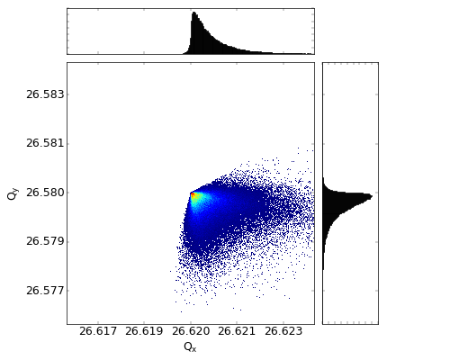

This repository provides a full simulation pipeline for realistic modeling of beam dynamics in CERN’s Super Proton Synchrotron (SPS) using [Xsuite](https://xsuite.readthedocs.io/en/latest/).  

It includes tools for lattice generation, octupole and RF settings, machine imperfections, wakefields and space charge effects, tracking and output analysis. 

Explore this repository on [Github](https://github.com/tprebiba/sps-xsuite-tracking).

 