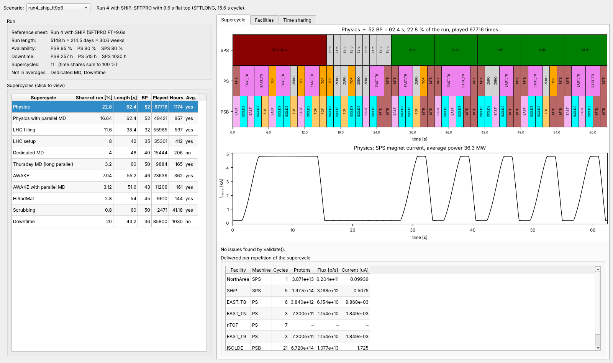

A Python package for modeling, analyzing, and optimizing the scheduling of cycles and supercycles in the CERN proton injector complex (PSB, PS, and SPS). It provides tools to describe and simulate how beam time is distributed across multiple facilities, both for present configurations and for planning future scenarios.

It includes tools for:
- Defining and editing supercycle structures for PSB, PS, and SPS.
- Estimating time-sharing and proton delivery to experiments.
- Visualizing supercycle usage with facility-level breakdowns.

Explore this repository on [Github](https://github.com/tprebiba/supercycles/tree/gui).

 
